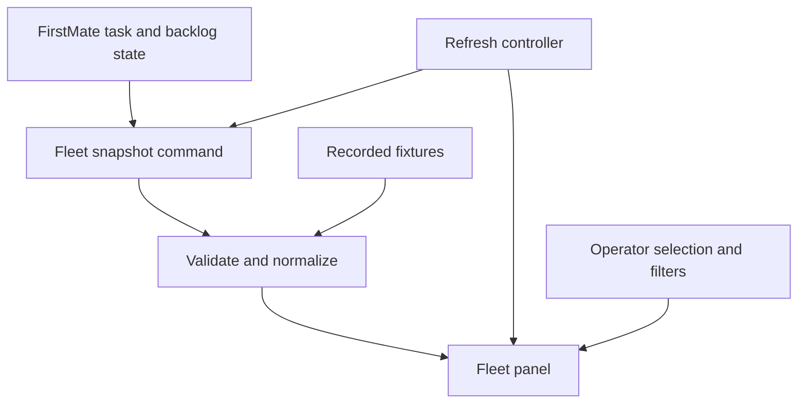

# FirstMate Fleet Panel for Herdr — Technical Specification and Implementation Plan

> **For agentic workers:** REQUIRED SUB-SKILL: Use superpowers:subagent-driven-development or superpowers:executing-plans to implement this plan task-by-task. The execution method is chosen at implementation time. Checkboxes track proposed work, not completed work.

**Goal:** Give the operator one trustworthy view of FirstMate work and decisions inside Herdr, beginning with an observational prototype.

**Architecture:** A Herdr JavaScript mod invokes FirstMate's existing JSON fleet snapshot command. A pure adapter validates and projects that snapshot into a native GPUI panel. FirstMate remains responsible for scheduling, task state, supervision and recovery.

**Tech stack:** JavaScript ES modules, Herdr's bundled `gpui-kit` and `gpui-base`, existing Bash/jq FirstMate tooling, and Node's built-in test runner for development only.

**Spec:** Sections 1–11 of this document are the design specification; section 12 is its implementation plan. Keep the complete document together.

**Date:** 2026-10-30. **Status:** Proposed implementation specification; no product code or runtime validation completed. **Owner:** Andrew Goldfinch. **Working repository name:** `firstmate-herdr-panel` (proposed, not created).

## 1. Decision and scope

Build a companion Herdr mod and reuse FirstMate's experimental upstream `hc` execution backend. Qualify that backend early rather than implement a duplicate. A fork of Herdr is unnecessary for the proposed prototype.

**Revision 2 — October 30, 2026:** FirstMate commit `355a30710d6e545fe57f720896ed440ee5d99a9a` supplies the backend previously planned for phase 2. This revision replaces backend construction with adoption, real-worker qualification and targeted fixes. The panel remains observational; a separate integration harness exercises worker lifecycle operations. No live validation has been performed for this specification update.

The prototype answers: what is underway, what needs the operator's attention, what has finished, and how trustworthy is that observation? It must improve navigation without introducing a second source of task truth.

### Approaches considered

| Approach | Benefit | Cost / decision |
| --- | --- | --- |
| Companion fleet mod using the existing snapshot | Delivers useful visibility with current workers | Selected basis for this specification; native worker attachment comes later |
| Reuse upstream `hc` alongside the panel | Native lifecycle without a duplicate adapter | Selected integration approach; qualify experimental behaviour before adoption |
| Fork the Herdr application | Full control of application internals | Extra maintenance; no demonstrated requirement for it |

The user requested this specification after the panel-first recommendation. Detailed defaults below are engineering proposals and may be revised during implementation review.

### Prototype includes

- One explicitly configured local FirstMate home per panel instance.
- Under way, Needs your attention, Recently finished, and queued/deferred context.
- Task details with state provenance, endpoint evidence, report paths and PR URLs.
- Search, filtering, manual refresh, automatic refresh and visible observation age.
- Explicit loading, unavailable, stale, incompatible and partial-data states.
- Recorded fixtures, fault scenarios and a paired comparison against the existing fleet view.

### Deferred

Launching, messaging, interrupting, retrying, killing or approving work **from the panel**; native worker focus/peek controls; remote command execution; multi-home aggregation; automatic notifications; full report-content reading; and Pi Durable experiment visualization. Existing remote secondmate summaries returned by the local snapshot may be displayed with their original provenance, but the panel makes no extra remote probes.

A separate qualification harness may launch, steer and terminate its own disposable workers through FirstMate. Upstream `hc` currently refuses all `--secondmate` spawns, not just remote ones. Existing child summaries remain display-only data.

The prototype does not assert durable task resumption or exactly-once external delivery. Those remain separate execution-provider questions.

## 2. Evidence and compatibility baseline

Source review established the following, not live interoperability:

| Component | Reviewed revision | Relevant contract |
| --- | --- | --- |
| FirstMate upstream | `df81d8166aab83f328aa3a05516cbe21882d5e23` | `fm-fleet-snapshot.v1`, fleet renderer and existing Herdr adapter |
| FirstMate upstream hc | `355a30710d6e545fe57f720896ed440ee5d99a9a` | Experimental `bin/backends/hc.sh`, operator documentation and verification record; adoption baseline |
| Herdr app | `8180cbe6c947519e8015dd7c35801a93e08a7d66` | Native JS mods, command execution, timers and live terminal data |
| Herdr core | `d02842335e33e4d70324e1122baeed8701f49e9b` | `hc` CLI, terminal RPCs, status and event semantics |

The opening contract of the adapter in `AndrewGoldfinch/firstmate`, branch `experiment/pi-durable-supervision`, was also inspected. It still describes the older `herdr` session/workspace/tab/pane interface. That branch is not assumed to contain the entire current upstream snapshot contract; phase 0 must check the actual checkout selected for the prototype.

The old `herdr` adapter is not interchangeable with `hc`: it uses old CLI commands, pane targets and pane events. The new core has terminal addresses, separate app presentation, program-reported status and a different event protocol. Do not alias `herdr` to `hc` or silently redirect the old backend.

### Updated qualification targets and evidence limits

Upstream now supplies a separate `hc` adapter. Reuse it. The earlier fork inspection does not establish whether the new commit is present in Andrew's branch; check ancestry and dependencies before adoption, without modifying the held Pi Durable experiment implicitly.

Qualify Herdr app **0.1.10** with herdr-core **0.1.15** as the initial target pair. Record actual binary versions, build revisions and checksums. Changelogs confirm these releases, not their compatibility with this project. Recheck the bundled mod API against the older source pins above. App 0.1.10 fixes `herdr-app check` crashes involving scrolling lists/layout animations; core 0.1.15 fixes restoration of kept terminals/spaces after shutdown or reboot. Restored shells do not establish task resumption.

Upstream verification primarily uses core 0.1.13 on macOS, plus a 0.1.14 socket-precedence probe. It reports lifecycle smoke tests, a stand-in scout's spawn/send/peek/teardown, and bare Claude Code/Codex liveness. Real-harness spawn, ship spawn, real composer submit confirmation, native status under FirstMate launch and app grouping remain explicitly unverified. Pi/OpenCode were not installed in that live guard. These are upstream-reported results, not tests run for this project.

Herdr mods run native GPUI through JavaScript. They do not have HTML, CSS, DOM, Node APIs or browser timers. Node is only a development/test tool. Use `cx.timer`, `cx.spawn` and the app's generated API declarations. Do not add a React/webview application.

## 3. Architecture and authority



The command is `bin/fm-fleet-snapshot.sh --json` from an explicitly configured FirstMate checkout. Do not independently parse `.meta`, backlog Markdown, terminal output or status logs in the panel. The snapshot already owns those interpretations.

Its observational caches may refresh under `state/secondmate-summary-cache`. “Observational” therefore means no supervision/task mutations, not literally zero filesystem writes. Setup checks and evaluation must account for those allowed cache writes.

Task state, task generation, terminal existence, agent liveness, program-reported status, attention and data freshness are separate concepts. A missing endpoint does not prove task failure; an existing shell does not prove an agent is running; a historical blocked event does not prove a current decision is open. Unknown values remain unknown.

## 4. Configuration, invocation and refresh

### Configuration

Use `mods/firstmate-fleet/config.json`, loaded through `readTextFile`. Initial defaults:

```json
{
  "schema": "firstmate-herdr-panel.config.v1",
  "firstmateRoot": "/absolute/path/to/firstmate",
  "firstmateHome": "/absolute/path/to/firstmate",
  "refreshMs": 15000,
  "staleAfterMs": 45000,
  "pageSize": 50
}
```

The paths are examples and must be configured. Require absolute nonempty paths and reject NUL bytes. Accept refresh intervals from 5,000 to 60,000 ms; require `staleAfterMs >= 3 * refreshMs`; page size is fixed at 50 in the prototype. Invalid configuration renders setup instructions and launches no command. A changed configuration clears the prior snapshot before sampling the new home.

Invoke the local command using arguments, never interpolated shell text:

```js
exec("env", [
  `FM_HOME=${config.firstmateHome}`,
  "bash",
  `${config.firstmateRoot}/bin/fm-fleet-snapshot.sh`,
  "--json"
], { cwd: config.firstmateRoot })
```

`env`, Bash and jq are runtime prerequisites on the FirstMate host. Phase 0 must verify that the chosen checkout honors this home selection and returns the requested `fm_home`. A mismatch is a configuration error; never show another home's data under the requested label. Do not change the process-wide HOME or guess environment overrides beyond this inspected contract.

Initial qualification target: Herdr app and FirstMate on the same Linux desktop host. WSLg is a separate qualification target; a Windows app talking to FirstMate in WSL is not claimed supported by this local invocation. A later remote mode can use `exec(..., {on: machine})` after path/environment qualification.

### Refresh controller

1. Fetch once on initialization, then on a 15-second timer. Manual refresh uses the same path.
2. Allow at most one outstanding snapshot command per panel instance. While busy, manual refresh does not enqueue more work; show Refreshing.
3. Herdr documents a 30-second execution limit and an 8 MiB output limit. Use the host limit; do not invent cancellation support. Reject nonzero exits and invalid or oversized output.
4. Schedule retries after failures at 15, 30, then 60 seconds, capped at 60. A successful refresh restores the normal interval. An idle manual refresh may bypass backoff.
5. Retain the last valid snapshot on transient failure, display the failure immediately, and label the retained data as historical. No prior snapshot means Unavailable, never an empty fleet.
6. Track a controller epoch and request number. Ignore results belonging to an old configuration or disposed view. Do not release an in-flight lock early and overlap a new command with a still-running old request.
7. Use a one-second lightweight UI timer for age display and the 45-second stale threshold. It must not launch a process each second.
8. Closing the panel invalidates callbacks and never kills workers. Hidden mods may keep running; use the conservative polling interval and document that cost. Do not assume an undocumented visibility callback exists.

The single-request guarantee applies to each live panel instance. Herdr may let a subprocess started by a disposed instance finish while a replacement instance starts a new request; brief overlap across hot reload is permitted and must be recorded. Old callbacks must never publish or schedule another request. Each invocation remains subject to the host's 30-second limit. Multiple intentionally installed panel copies also poll independently. The prototype does not promise a process-wide lock or cancellation facility.

Herdr's live UI state should be read during rendering, not independently polled. Native terminal data is not required for this prototype.

## 5. Data contract and normalization

### Producer validation

Accept only the exact top-level schema `fm-fleet-snapshot.v1` for the prototype. Require a JSON object, valid `generated` timestamp, matching `fm_home`, `tasks` array and `backlog.records` array. Unknown additive fields are ignored. An unsupported schema or invalid required container invalidates the refresh; retain a previously valid sample with an incompatibility banner.

Validate individual records independently. Malformed rows are omitted with counts and reasons. Preserve valid rows; never turn a partially readable fleet into “all clear.” Optional surfaces missing from an older v1 producer display Unavailable for that surface, not zero. Phase 0 must capture the exact field shapes used below as sanitized fixtures before coding the adapter.

### Internal contract

The following types describe the proposed panel model, not additional FirstMate API fields:

```ts
type Evidence<T> = {
  value: T | null;
  source: string | null;
  observedAt: string | null;
  quality: "reported" | "cached" | "unknown";
};
type Freshness = {
  source: string | null;
  observedAt: string | null;
  sourceAgeSeconds: number | null; // producer-reported age at collection
  quality: "reported" | "cached" | "unknown";
};
type Disclosure = {code: string; message: string; count: number | null};
type FleetRow = {
  key: string;                 // encoded tuple of home, origin, producer identity
  taskId: string | null;
  generation: string | null;   // only when explicitly supplied by producer
  title: string;
  project: string | null;
  repository: string | null;
  origin: "task" | "backlog" | "secondmate";
  state: Evidence<string>;
  endpoint: Evidence<"present" | "absent">;
  agentLiveness: Evidence<string>; // retains unknown / not_checked vocabulary
  attention: "required" | "deferred" | "unknown" | "none";
  attentionReason: string | null;
  holdBucket: string | null;
  blockerIds: string[];
  freshness: Freshness;
  disclosures: Disclosure[];
  backend: string | null;
  artifacts: Array<{kind: "report" | "pr"; value: string}>;
};
type ChildSummary = {
  key: string;
  home: string | null;
  freshness: Freshness;
  availability: "available" | "partial" | "unavailable";
  counts: Record<string, number | null>;
  rows: FleetRow[];
  disclosures: Disclosure[]; // includes producer omissions/truncation
};
type PanelModel = {
  home: string;
  generatedAt: string;
  receivedAtMs: number;
  rows: FleetRow[];
  childSummaries: ChildSummary[];
  disclosures: Disclosure[];
};
type DecodeResult =
  | {ok: true; model: PanelModel}
  | {ok: false; code: string; message: string};
```

Stable keys use a JSON-encoded tuple, not an ambiguous string concatenation. Duplicate identifiers within one origin are disclosed as ambiguous and not silently merged. Never join task and backlog records on title or display label. A producer-exposed generation is part of identity when present. When absent, replace details from each newly accepted snapshot and clear row selection; do not retain task-specific UI state across refreshes and assume identity continuity.

### Projection rules

| Input | Panel use | Required safeguard |
| --- | --- | --- |
| `tasks[].current_state` | State and source in Under way / details | Preserve unknown values and raw state names; no screen inference |
| `tasks[].endpoint` | Separate endpoint evidence | `agent_alive=unknown/not_checked` is not false |
| `tasks[].hints.pending_decision` | Current task attention when explicitly true | Historical status-log events are not a fallback classifier |
| `backlog.records[]` | Queue, holds, completed work | Preserve unstructured rows as unclassified context |
| `captain_actionable`, `hold_bucket`, blockers | Attention versus deferred work | Do not parse hold-reason prose; contradictory inputs get a disclosure |
| Task PR and report path fields | Detail references | A path is not proof that an artifact is currently readable |
| `secondmate_current` | Separate child-home summary area | Keep cached, partial, unavailable, truncated and omitted metadata |
| `main_inventory` | Inventory-warning banner | Orphan backlog entries do not become invented live workers |

An explicitly actionable hold or current pending decision enters Needs your attention. A structured non-actionable hold enters Deferred with its reason. Missing decision evidence is unknown, not “none.” Completed backlog rows enter Recently finished; source order is retained unless a trustworthy completion timestamp exists. Do not assign a finish time based on snapshot receipt.

Task and backlog origins stay distinct in the MVP. When both refer to the same task ID, show related records in details without double-counting them as independent live workers. Counts must identify their unit, such as “3 task decisions” versus “2 backlog holds.”

Snapshot `generated` time indicates collection freshness, not the freshness of each child record. Store successful receipt time using a monotonic clock for elapsed timers when the host exposes one; otherwise inject a clock abstraction and clamp backward wall-clock movement to zero while flagging the anomaly. Preserve source timestamps and cached ages.

Compute receipt age from elapsed time since successful receipt. At receipt, compute producer age from local wall time minus `generated`; subsequently advance that age by elapsed time. The parent snapshot is stale when either age reaches `staleAfterMs`. Thus a newly received snapshot generated two minutes ago is immediately stale. A producer timestamp more than five seconds in the future, or an unexplained backward clock jump without a monotonic clock, marks freshness uncertain and stale with a clock-skew disclosure; small negative producer ages within tolerance clamp to zero. A fresh fetch does not clear this condition unless its timestamps are trustworthy.

Child freshness is independent: advance a supplied source age by elapsed time since receipt, preserve cached classification, and never substitute parent age for missing child age. Render child provenance/omissions from `ChildSummary`, and task detail/search fields from `FleetRow`; the view must not read raw producer JSON. Missing counts remain null rather than zero.

## 6. User interface

Use one mod named `firstmate-fleet`, initially docked on the right with a proposed width of 420 logical pixels. `mod.json` contains `{ "place": "right", "size": 420 }`. The root class extends `View`; render from a pure model and keep commands out of `render`.

- Header: home label, collection age, refresh state, Refresh action and search.
- Needs your attention: task decisions and actionable holds, grouped with explicit counts. Deferred items are reachable alongside this list with their gate/reason.
- Under way: task ID, title, state, backend and evidence indicator. Unknown or missing endpoints remain visible.
- Recently finished: completed backlog entries in producer order, with source labels.
- Details: full title, exact state/source, endpoint evidence, artifact references and any partial-data warnings.

Tabs or compact sections may be selected by the implementer, provided keyboard navigation and all four information groups remain available. Use text labels with colour; colour alone cannot convey unknown, blocked or stale state. Preserve full values in details when rows truncate long text.

Render 50 rows per page after filtering, with total matches and page controls. Search matches literal case-insensitive task ID, title and project/repository text; it never evaluates regexes. Make search/selection deterministic for fixture tests. Support keyboard focus, Enter to select and Escape to leave details using the actual bundled GPUI APIs.

MVP artifact references are selectable text. Opening a browser/editor is deferred unless the implementation verifies a safe native API and covers it in the same review. Do not shell-execute paths or URLs from task data. No automatic report reading or arbitrary embedded markup rendering is required.

Expected empty and failure text:

| Condition | Display |
| --- | --- |
| First load | “Loading fleet…” |
| Valid empty snapshot, no disclosures | “No tasks reported for this home.” |
| Missing setup | “Configure a FirstMate checkout and home.” |
| Failed refresh with prior data | “Refresh failed — showing the last successful snapshot.” |
| Age exceeds threshold | “Snapshot is stale.” with age |
| Unsupported schema | “This FirstMate snapshot version is not supported.” |
| Partial results | “Some fleet information is unavailable.” with expandable reasons |

Never present a positive “all clear” when any required attention surface is unavailable.

## 7. Safety, observability and packaging

Herdr mods run trusted code with the user's permissions. Ship no credential handling, background network service or telemetry. The snapshot subprocess inherits the user environment, as Herdr documents; do not log that environment.

The panel's execution allowlist contains only the configured snapshot invocation. Task content is data, never code or shell fragments. The panel must not call FirstMate send/watch/teardown/spawn commands, `hc kill`, or any app action that closes worker panes. Cached summaries are the only allowed producer-side state writes during observational tests. The integration harness may mutate its own disposable tasks through FirstMate. Separate these deliberate lifecycle operations from the panel's zero-mutation measurement.

Keep the last 50 diagnostic entries in memory: request number, timestamps, elapsed time, exit code, byte count, row/disclosure counts and error category. Do not retain raw stdout, report content or unredacted stderr by default. Show a bounded, sanitized error summary; fixture export is explicit and sanitized.

Distribute the mod folder plus install/uninstall instructions. Installation copies only `mods/firstmate-fleet`; it does not overwrite shipped mods, layouts or key bindings. Existing installations require a config backup before replacement. Uninstall removes that mod/layout reference and leaves all FirstMate tasks and their state intact.

## 8. Test environment and comparison harness

### Reproducible setup

Create a disposable FirstMate home and small synthetic fleet. Pin the three source revisions and record the actual app/core versions, OS, CPU and selected FirstMate home contract. Do not use the Pi Durable experiment's production/home state. Use deterministic fixture JSON derived from the pinned producer and synthetic identifiers with no credentials or private report content.

Hold the FirstMate revision, execution backend, harness version and captured data constant across comparison arms. Otherwise a backend upgrade could be mistaken for a panel benefit. Pi Durable evaluation is a separate experiment.

Run two views of the same captured snapshot: the existing fleet renderer and the panel. The baseline adapter may replace only the snapshot-command boundary in a disposable test copy; it must not rewrite the baseline's presentation. For decision tasks, allow the baseline operator its normal FirstMate CLI tools, record which were used, and keep the underlying fleet frozen. This prevents the comparison from deliberately handicapping the existing workflow.

Live integration uses harmless shell workers and isolated state. Record changes to task metadata, backlog, reports and worker process identities before/after panel polling. Separate and permit the producer's documented observational cache changes. On teardown, verify process liveness directly without causing supervision actions.

### Required scenarios

| ID | Scenario | Expected result |
| --- | --- | --- |
| P01 | Empty valid fleet | Explicit empty state, no error |
| P02 | Running, waiting and finished work | Correct groups; current state separate from endpoint |
| P03 | Current decision plus dated/blocked holds | Actionable and deferred items distinguished |
| P04 | Cached remote secondmate summary | Cache/source age visible even after fresh collection |
| P05 | Producer failure, then recovery | Last good data retained, error cleared after success |
| P06 | Old or malformed schema | Rejected with explanation; no fabricated empty fleet |
| P07 | Missing endpoint / unknown liveness | Unknown preserved; no inferred completion |
| P08 | Duplicate ID, replaced generation, home switch | No cross-identity selection/data carryover |
| P09 | Slow requests and repeated Refresh | At most one in flight; no stale response overwrite |
| P10 | Missing optional surfaces, omitted rows, truncation | Visible disclosures; valid information retained |
| P11 | Quotes, shell syntax, Unicode and huge titles | Plain text only; no extra commands executed |
| P12 | App panel close, hide and hot reload | No worker mutation; no surviving old polling loop; any permitted old-process overlap recorded |
| P13 | Clock jump/skew and old timestamps | Age anomaly disclosed; no false freshness |
| P14 | 500 tasks and 500 backlog rows | Bounded rendering and stable search/page behavior |
| P15 | Existing checkout lacks required snapshot support | Setup blocks with a compatibility explanation |

### Five benefit measures

All thresholds are proposed prototype gates, not measured results.

| Benefit | Measurement | Prototype target |
| --- | --- | --- |
| Faster triage | Paired time to identify an actionable task and its reason | At least 25% lower median than baseline; no accuracy regression |
| Less navigation | Count operator actions to locate a task's report/PR reference | At least 30% lower median; same correct artifact |
| Better state understanding | Correct answers for stale, cached, unknown and disconnected cases | 100% on deterministic fixtures; no false “healthy/done” answers |
| Lower operational risk | Authoritative state diff and worker identity checks | Zero panel-triggered task mutations or worker stops |
| Practical responsiveness | Local normalize/project duration and host render checks | p95 normalization under 100 ms for P14; UI updates within 1 second after response; one request per live instance |

For a directional usability pilot, run 12 matched scenarios with Andrew using both views, alternate order, and use equivalent task names to reduce memorization. Log errors, time and action counts. Report medians and paired differences; this single-operator pilot does not establish general user benefit. A later rollout study should recruit other operators and predeclare its sample size.

Measure snapshot collection latency separately from panel overhead. The collector may dominate wall-clock refresh time. Do not claim the 1-second target includes collecting the fleet.

## 9. Acceptance and rollout gates

Panel acceptance requires all of the following. Claiming an integrated hc prototype additionally requires the phase 0b milestone in section 10:

- P01–P15 pass with recorded evidence; critical state/identity tests cannot be waived by usability gains.
- `node --test tests/*.test.mjs` passes in the proposed companion repo.
- `herdr-app check <installed-mod-path>` exits zero on the qualified host; this render-once check supplements live asynchronous testing.
- A 30-minute live polling session demonstrates failure/recovery, manual refresh, close and hot reload without task mutation or duplicate loops.
- Diagnostics, versions, fixture revision and benchmark results are attached to the implementation review.
- Unsupported configurations are documented accurately. Native Windows/WSL bridging is not claimed from a Linux-only result.

Roll out manually to one home. Roll back by removing the mod; no task-state migration is needed. If correctness passes but usability targets miss, retain an experimental label and use observations to revise the UI before extending scope.

## 10. Revised phases — adopt, qualify, then extend

| Phase | Deliverable | Entry / exit condition |
| --- | --- | --- |
| 0 — qualification | Current snapshot fixtures, native mod shell and isolated upstream hc checkout | Actual checkout contract, dependencies and host APIs recorded |
| 0b — first integration milestone | One real FirstMate task launched, visible in Herdr, steered, inspected and terminated without affecting a sentinel task | I01–I04 below pass for one installed real harness |
| 1 — prototype | Observational fleet panel | P01–P15 and panel acceptance gates pass |
| 1b — usability/remote | Qualified remote snapshot execution, artifact opening and optional multi-home views | Separate machine/path isolation tests; no assumption that hc secondmates are supported |
| 2 — backend qualification and hardening | Reused upstream hc backend, documented harness matrix and narrowly scoped fixes | I01–I10 run; every advertised supported combination passes its required tests |
| 3 — controlled panel actions | Focus/peek, then selected FirstMate actions | Fresh identity verification and FirstMate action checks; separate design review |
| 4 — experiment view | Baseline/durable result display | Versioned result contract; outcome append and external delivery metrics separate |

Phase 0b can run alongside fixture/UI work. Its failure blocks claims of an integrated hc prototype, but need not block a panel tested against existing backends. Do not build a second adapter to bypass a qualification failure.

### Existing adapter contract to preserve

- Explicit selection through FirstMate's backend configuration or explicit launch option; inherited `HC_TERMINAL_ID` must not select hc.
- One terminal per task, with Treehouse continuing to own worktrees.
- Creation uses `--no-parent --outlive-parent --no-notify`, giving workers lifetimes independent of the terminal running FirstMate.
- Metadata records `backend=hc`, `window=<session>:<address>`, `hc_session` and `hc_terminal`.
- Labels `firstmate.task` and `firstmate.home` are checked before operations requiring ownership. Display names alone must never authorize an action.
- Every adapter call restores the recorded `HC_SESSION` and drops inherited `HC_SOCKET`, which otherwise takes precedence.
- `hc send` submits automatically. FirstMate handles the launch-line Enter and composer confirmation; do not add another unconditional Enter in an integration layer.
- Liveness checks include local process-group inspection when the foreground program is a wrapper. This is not evidence of remote process visibility.
- Teardown kills, removes and verifies absence. Supervision currently polls; the adapter does not consume core events.
- Native program status under real FirstMate launches and visual grouping by `herdr.space` / `herdr.tab` remain qualification targets.
- All `--secondmate` spawns are refused by the documented adapter.

### Integration test environments

Use a dedicated checkout or worktree containing the upstream merge and its dependencies. Inspect the user's fork before choosing rebase/merge/cherry-pick; do not assume one file is sufficient. Leave the held Pi Durable branch and its frozen conclusions unchanged.

For CLI lifecycle and fault tests, use a short private temporary root, unique `HC_SESSION`, and isolated XDG state/runtime directories as upstream does. Record and sanitize inherited HC variables. Upstream encountered Unix socket length limits; long workspace paths are unsuitable for these private sockets.

**App visibility requires a separate setup:** the reviewed documentation says Herdr.app displays the `default` session. A named private-core test therefore cannot prove visual integration. Use a disposable OS user/VM with app and core sharing the same default-session environment and an isolated FirstMate home. Create a separate sentinel task, and never stop the user's normal default core. Do not assume undocumented app session switching works.

Use harmless synthetic repositories and bounded prompts. Existing agent authentication is configured outside fixtures; record versions and redact credentials/output. Integration logs identify which operator/harness initiated mutations. A skipped test is not a pass.

### Integration acceptance matrix

| ID | Probe | Required evidence |
| --- | --- | --- |
| I01 | Run upstream adapter tests on the target versions | Unit/fake, private-core smoke and installed-harness liveness results; explicit skips |
| I02 | Real task through FirstMate | Spawn in an isolated worktree, process recognized, bounded prompt produces expected artifact; repeat scout and ship paths before claiming both |
| I03 | App visibility and grouping | Task appears in the disposable default-session app; observed space/tab mapping and actual terminal identity recorded |
| I04 | Steering, inspection and teardown | One follow-up submitted once, correct captured output/state, task removed, sentinel PID/terminal unchanged |
| I05 | Selection and session isolation | Inherited HC markers do not select backend; conflicting HC_SOCKET/HC_SESSION cannot redirect recorded-task operations |
| I06 | Ownership and replacement | Same task IDs in different homes, mismatched labels and stale/replaced targets refuse misdirected input/termination; disclose any same-label replacement gap |
| I07 | Real composers and status | Separate results for submit confirmation, wrapper liveness and native status for Claude Code, Codex, Pi and OpenCode |
| I08 | Parent loss and core restart | Expected independent lifetime on parent exit; crash/restart state is honest, no duplicate launch or false resumed-agent claim |
| I09 | Kept-terminal restore and stale callbacks | Test kept-shell restoration separately from non-kept FirstMate tasks; delayed old observations never update a replacement generation |
| I10 | Unsupported modes | hc secondmate attempts fail clearly; panel remains able to display valid existing summaries without probing or spawning them |

For I07 classify each dimension as PASS, FAIL, NOT RUN or UNSUPPORTED, recording exact versions. Missing native status is displayed as unknown and does not automatically fail observational panel acceptance; it blocks claims of native-status support. Missing installation/authentication is NOT RUN, not UNSUPPORTED.

The minimum integrated milestone requires I01–I04 with one real installed harness on app 0.1.10/core 0.1.15. Broader support claims require the relevant I05–I10 safety tests and per-harness results. Do not claim all four harnesses from a stand-in or bare-process liveness test.

### Hardening after qualification

Fix demonstrated gaps in the reused upstream adapter and contribute focused changes where appropriate. Label/task checks are existing safeguards, not proof of generation-safe ownership after every restart. Test same-label replacement and record any missing fence before enabling panel actions.

Event-driven supervision remains optional future work. If introduced, honor initial snapshots and missed-event resynchronization; do not imply the current polling adapter already does this. The core 0.1.15 restoration fix and independent worker lifetimes do not prove durable execution or exactly-once external delivery.

## 11. Global constraints and review focus

Global constraints: observational-only panel; exact supported schema; one local home per panel; 15-second default refresh; 45-second stale threshold; one request in flight per instance; 50 rows per page; native GPUI runtime; no raw task-text execution; no worker controls exposed by the panel; unknown evidence preserved. The isolated qualification harness may perform the lifecycle operations in section 10.

Review focus, assigned to tests below:

1. A fresh parent observation containing old cached child evidence (Task 1).
2. An old request returning after the configured home changes (Task 2).
3. A mod hidden or hot-reloaded while work is still in flight (Task 3).
4. Same task labels or IDs representing different origins/generations (Task 1).
5. Baseline measurements using different source data or omitted normal CLI tools (Task 4).

## 12. Implementation plan

Proposed repository files and responsibilities:

| Path | Responsibility |
| --- | --- |
| `mods/firstmate-fleet/main.js` | View lifecycle, native UI and event wiring |
| `mods/firstmate-fleet/mod.json` | Docking metadata |
| `mods/firstmate-fleet/config.example.json` | Explicit setup defaults |
| `mods/firstmate-fleet/config.js` | Config parsing and validation |
| `mods/firstmate-fleet/snapshot.js` | Decode producer contract and preserve evidence |
| `mods/firstmate-fleet/project.js` | Pure grouping, search and pagination |
| `mods/firstmate-fleet/controller.js` | Refresh state machine with injected host and clock |
| `mods/firstmate-fleet/host.js` | Narrow wrapper around Herdr execution and file reads |
| `tests/fixtures/*.json` | Sanitized producer samples and fault cases |
| `tests/*.test.mjs` | Contract, controller and projection tests |
| `eval/scenarios.json` | Frozen paired tasks and answer keys |
| `eval/results.csv` | Measured results, initially header-only |
| `docs/qualification.md`, `README.md`, `AGENTS.md` | Compatibility evidence, install/rollback and project boundaries |

### Task 0 — qualify the host and capture the producer contract

**Files:** `docs/qualification.md`, `tests/fixtures/`, initial `README.md` and `AGENTS.md`.

**Consumes:** the pinned sources and configured checkout. **Produces:** sanitized fixtures, a field-mapping table with actual example values, and a qualified local host record.

- [ ] Verify the selected checkout exposes the required command, honors `FM_HOME`, and returns `fm-fleet-snapshot.v1` for the requested home.
- [ ] Capture representative normal, decision, deferred, cached and partial snapshots; record producer versions and scrub private data.
- [ ] Verify the bundled native text-input, selectable-text and keyboard APIs. Record exact APIs instead of assuming browser equivalents.
- [ ] Record setup/rollback and the observational-only command boundary in `AGENTS.md`.
- [ ] Review and commit the qualification evidence. If the checkout lacks the contract, stop product implementation and identify the minimal upstream update required; do not alter the durable experiment implicitly.

### Task 0b — reuse and qualify the upstream hc integration

**Files:** `docs/hc-qualification.md`, `eval/hc-matrix.csv`, `eval/hc-scenarios.md`; any actual adapter fixes belong in the isolated FirstMate checkout, not the mod.

**Consumes:** Task 0 host/checkout record and upstream hc implementation. **Produces:** a real-worker milestone result, versions and evidence for I01–I10. The panel consumes no worker-control interface from this task.

- [ ] Confirm the selected checkout contains commit `355a30710d6e545fe57f720896ed440ee5d99a9a` or an inspected equivalent and its dependencies; record the actual checkout SHA and snapshot fixture revision.
- [ ] Run from that checkout: `bash tests/fm-backend-hc.test.sh`, `bash tests/fm-backend-hc-smoke.test.sh`, and `bash tests/fm-backend-hc-liveness-live-e2e.test.sh`. Require the documented completion markers and inspect skipped-harness output; exit zero alone is insufficient.
- [ ] Run I02–I04 in the disposable default-session app setup, using existing FirstMate commands, one real harness and a sentinel. Record the artifact, steering result, visual identity and teardown evidence.
- [ ] Run I05–I10 in their appropriate private/default environments. Record one row per test/harness/version with result and evidence path; do not mark planned probes as completed.
- [ ] If a probe fails, add a focused regression test in FirstMate before modifying its adapter. Preserve existing selection/ownership safeguards and rerun affected upstream tests.
- [ ] Commit the qualification report independently of panel code. A failed milestone leaves the panel available for existing backends and the hc integration explicitly experimental.

### Task 1 — normalize and project snapshots

**Files:** `snapshot.js`, `project.js`, `config.js`, `tests/snapshot.test.mjs`, `tests/project.test.mjs`, `tests/config.test.mjs`, and ES-module package metadata.

**Interfaces:** `parseConfig(text: string): ConfigResult`; `decodeSnapshot(text: string, expectedHome: string, receivedAtMs: number): DecodeResult`; `projectFleet(model: PanelModel, query: string, section: string, page: number): PageModel`. `ConfigResult` is an ok/error union with the section 4 fields. `PageModel` contains rows, totalMatches, page, pageSize and disclosures; page is zero-based and clamped to the available range. Export typedefs alongside each module.

- [ ] Write failing tests for P01–P04, P06–P08, P10–P11 and P15. Assert `unknown` survives, cached child evidence remains cached, deferred holds are excluded from actionable counts, and malformed rows create disclosures.
- [ ] Assert duplicate identities remain ambiguous and refresh without generation clears selection through the controller contract. Assert page size equals 50 and search treats `.*` literally.
- [ ] Run `node --test tests/config.test.mjs tests/snapshot.test.mjs tests/project.test.mjs`; confirm failures reflect missing behavior.
- [ ] Implement the three pure modules using the qualified field mapping, preserving unsupported optional surfaces as unavailable.
- [ ] Run the same tests to passing and commit the adapter/projection change.

### Task 2 — implement command transport and refresh control

**Files:** `host.js`, `controller.js`, `tests/controller.test.mjs`, `tests/host.test.mjs`.

**Interfaces:** `createController({host, clock, onChange})` returns `configure(config)`, `refresh()`, `tick()`, `dispose()` and `getState()`. Injected `host.fetchSnapshot(config)` returns a promise of `{code, stdout, stderr}`. `clock.nowMs()` drives elapsed time; `clock.wallTimeMs()` checks source timestamps. State exposes model, loading, error, stale, lastSuccessMs and nextAttemptMs. `tick()` is driven by the view timer; the controller contains no runtime-specific timers.

- [ ] Write failing fake-clock tests for P05, P09 and P13: ten simultaneous refresh calls create one subprocess; failures back off 15/30/60 seconds; an old-home result never replaces a new-home model; dispose suppresses publication.
- [ ] Assert transient failure retains valid data, stale becomes true at 45 seconds, a newly received two-minute-old snapshot is immediately stale, future timestamps beyond five seconds are uncertain/stale, config change clears data, and request lock remains held until the outstanding operation settles.
- [ ] Assert host invocation passes separate arguments with the exact allowed command; shell-looking task content never enters argv.
- [ ] Run `node --test tests/controller.test.mjs tests/host.test.mjs`, observe the expected failures, implement the interfaces, rerun to passing and commit.

### Task 3 — integrate the native fleet view

**Files:** `main.js`, `mod.json`, `config.example.json`, `tests/view-model.test.mjs`, install/rollback documentation.

**Consumes:** Tasks 1–2 interfaces. **Produces:** the installable mod and qualified native UI.

- [ ] Add view-model assertions for section counts, missing evidence banners, artifact text and selection clearing on generation-unknown refresh.
- [ ] Implement the `View` lifecycle with `cx.spawn`, `cx.timer.every` and callback-local contexts. Never retain `cx` for later callbacks. Wire refresh, search, pagination and details without worker actions.
- [ ] Run `node --test tests/*.test.mjs` and `herdr-app check <installed-mod-path>`; require both to pass.
- [ ] Execute P12 live: hide, show, close and hot reload during collection. Confirm an old instance never publishes or schedules another request and no workers terminate. Record permitted old-subprocess overlap and confirm each command reaches completion or the host limit.
- [ ] Inspect native layout at narrow/wide panel sizes and with keyboard navigation, long titles and error messages. Commit the mod with verification evidence.

### Task 4 — run the paired evaluation and package the prototype

**Files:** `eval/scenarios.json`, `eval/results.csv`, `docs/evaluation.md`, final `README.md`.

**Consumes:** installable mod, fixed fixtures and baseline renderer. **Produces:** measured acceptance report and prototype release package.

- [ ] Build the 12 matched operator scenarios and explicit answer keys; include command use/action counting rules and alternated view order.
- [ ] Add an evaluation check that both arms receive the same fixture digest and record any supplementary baseline CLI tools. Exclude mismatched trials instead of comparing them.
- [ ] Run P01–P15, the 30-minute live session and P14 timing measurements. Record authoritative-state diffs separately from allowed cache updates.
- [ ] Conduct the paired pilot, calculate the five benefit measures and report actual passes/misses without converting proposed targets into results.
- [ ] Package the mod and install/rollback instructions. Report panel acceptance separately from the I01–I04 integrated milestone and I05–I10 support matrix. Commit measured results; retain experimental labels for unqualified combinations.

## 13. Source references

Revision 2 additions (reviewed October 30, 2026):

- [Upstream hc implementation commit](https://github.com/kunchenguid/firstmate/commit/355a30710d6e545fe57f720896ed440ee5d99a9a)
- [hc backend operator contract](https://github.com/kunchenguid/firstmate/blob/355a30710d6e545fe57f720896ed440ee5d99a9a/docs/hc-backend.md)
- [hc adapter source](https://github.com/kunchenguid/firstmate/blob/355a30710d6e545fe57f720896ed440ee5d99a9a/bin/backends/hc.sh)
- [Upstream live verification record](https://github.com/kunchenguid/firstmate/blob/355a30710d6e545fe57f720896ed440ee5d99a9a/docs/verification/runtime-backends.md#hc)
- [App changelog: 0.1.10](https://github.com/herdrdev/herdr-app/blob/master/CHANGELOG.md)
- [Core changelog: 0.1.15](https://github.com/herdrdev/herdr-core/blob/master/CHANGELOG.md)

The changelog links follow upstream; qualification must record immutable revisions and binary checksums. Earlier source pins below remain the panel design's inspected API baseline, not its newly qualified runtime versions.

These are the primary sources used for the design. Source pins are review baselines, not a claim that later releases are compatible.

- [FirstMate snapshot contract](https://github.com/kunchenguid/firstmate/blob/df81d8166aab83f328aa3a05516cbe21882d5e23/bin/fm-fleet-snapshot.sh)
- [FirstMate fleet renderer](https://github.com/kunchenguid/firstmate/blob/df81d8166aab83f328aa3a05516cbe21882d5e23/bin/fm-fleet-view.sh)
- [Existing FirstMate Herdr adapter](https://github.com/kunchenguid/firstmate/blob/df81d8166aab83f328aa3a05516cbe21882d5e23/bin/backends/herdr.sh)
- [Herdr app mod guide](https://github.com/herdrdev/herdr-app/blob/8180cbe6c947519e8015dd7c35801a93e08a7d66/defaults/AGENTS.md)
- [Herdr app API declarations](https://github.com/herdrdev/herdr-app/blob/8180cbe6c947519e8015dd7c35801a93e08a7d66/defaults/herdr.d.ts)
- [Herdr core CLI](https://github.com/herdrdev/herdr-core/blob/d02842335e33e4d70324e1122baeed8701f49e9b/docs/commands.md)
- [Herdr core protocol and event semantics](https://github.com/herdrdev/herdr-core/blob/d02842335e33e4d70324e1122baeed8701f49e9b/schema/README.md)
