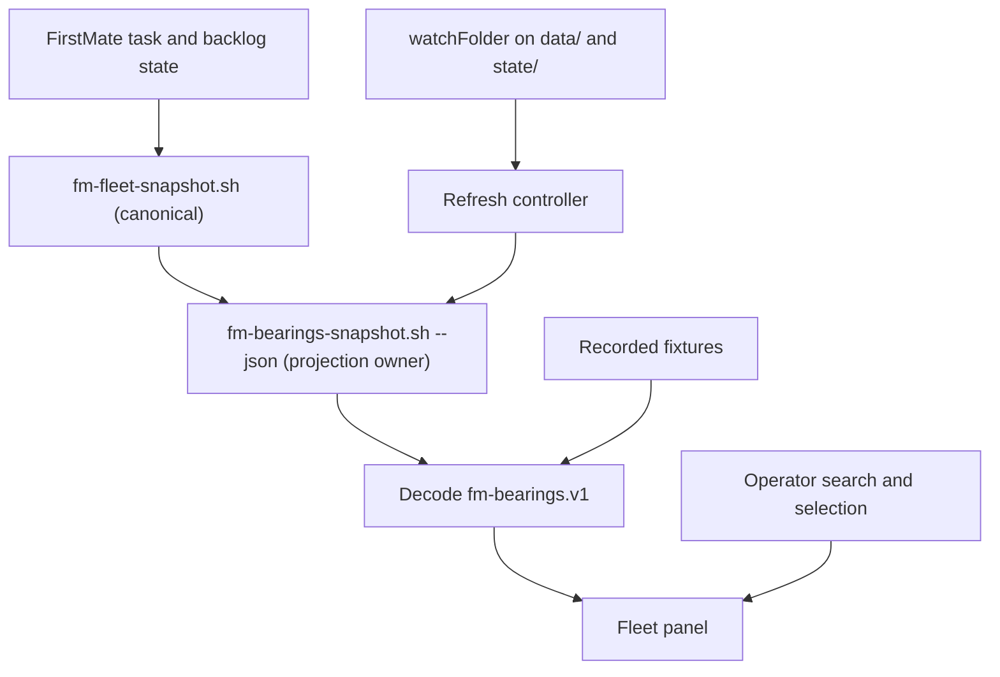

# FirstMate Fleet Panel for Herdr — Technical Specification and Implementation Plan

> **For agentic workers:** REQUIRED SUB-SKILL: Use superpowers:subagent-driven-development or superpowers:executing-plans to implement this plan task-by-task. The execution method is chosen at implementation time. Checkboxes track proposed work, not completed work.

**Goal:** Give the operator FirstMate's Bearings picture as a native, always-visible Herdr panel, beginning with an observational prototype.

**Architecture:** A Herdr JavaScript mod invokes FirstMate's existing Bearings projection, `bin/fm-bearings-snapshot.sh --json`. A thin decoder validates that model and the panel renders its sections as given. FirstMate remains responsible for scheduling, task state, classification, supervision and recovery.

**Tech stack:** JavaScript ES modules, Herdr's bundled `gpui-kit` and `gpui-base`, existing Bash/jq FirstMate tooling, and Node's built-in test runner for development only.

**Spec:** Sections 1–11 of this document are the design specification; section 12 is its implementation plan. Keep the complete document together. Qualification of FirstMate's `hc` backend, previously phases 0b and 2 here, is now the separate [hc qualification specification](2026-10-30-firstmate-hc-qualification-spec.md); the panel consumes nothing from it.

**Date:** 2026-10-30. **Status:** Proposed implementation specification, revision 3; no product code or runtime validation completed. **Owner:** Andrew Goldfinch. **Working repository name:** `firstmate-herdr-panel` (proposed, not created).

## 1. Decision and scope

Build a companion Herdr mod that renders FirstMate's Bearings model. Do not reimplement fleet classification in the mod. A fork of Herdr is unnecessary for the proposed prototype.

**Revision 3 — October 30, 2026:** A source review found that FirstMate's Bearings (`/bearings`, `bin/fm-bearings-snapshot.sh`, schema `fm-bearings.v1`) already projects the fleet snapshot into the groups this panel needs, and that FirstMate assigns that projection a single owner. This revision:

- replaces the panel's own projection of `fm-fleet-snapshot.v1` with a decoder of `fm-bearings.v1`, and adopts FirstMate's section names;
- makes refresh change-driven and records what each collection costs, including remote and GitHub reads;
- scrubs inherited path and clock overrides, and verifies the home from task paths;
- uses the plain `/bearings` digest as the evaluation baseline;
- collapses the FirstMate source pins to one revision;
- moves hc backend qualification to its own document.

No live validation has been performed for this revision.

**Revision 2** adopted upstream `hc` instead of building a backend. That work continues in the hc qualification document.

The prototype answers: what needs the captain, what is underway, what has landed, what is charted next, and how trustworthy is that observation? It must improve navigation without introducing a second source of task truth or a second classification of it.

### Approaches considered

| Approach | Benefit | Cost / decision |
| --- | --- | --- |
| Render the Bearings model (`fm-bearings-snapshot.sh --json`) | Same sections, hold buckets and disclosures as `/bearings`; no second projection | **Selected.** Each collection runs the full canonical snapshot, including remote-home reads (section 4) |
| Decode `fm-fleet-snapshot.v1` and project in the mod | Full field access, including `spawn_gen` | Rejected: repeats Bearings' hold-bucket, landed-merge and gate rules, which FirstMate assigns one owner. This was the revision 2 design |
| Read `state/home-summary.json` directly | No subprocess; FirstMate's watcher, spawn, teardown and session start republish it atomically | Rejected for the prototype: local home only, and its `decisions_open` mixes status-log decisions with captain holds, so the mod would have to repeat Bearings' filtering and gate derivation |
| Fork the Herdr application | Full control of application internals | Extra maintenance; no demonstrated requirement for it |

The user requested this specification after the panel-first recommendation. Detailed defaults below are engineering proposals and may be revised during implementation review.

### Existing surfaces the panel must not duplicate

| Surface | Owner | Panel relationship |
| --- | --- | --- |
| Bearings digest and projection | FirstMate `bearings` skill; `bin/fm-bearings-snapshot.sh` | Data source. The panel renders it and adds no classification |
| Bearings lavish board | `bin/fm-bearings-board.sh`; answers through `bin/fm-captain-hold.sh` | The guarded path for decision answers and merge orders. Any later panel action reuses it (section 10) |
| Fleet view | `bin/fm-fleet-view.sh` | Markdown tables over the canonical snapshot, with no decisions section; not the evaluation baseline (section 8) |
| Fleet activity ledger | `state/fleet-ledger.jsonl`, opt-in per home | Documented hook for outside tools; carries `task.merged` times. Phase 1b candidate; not read in the prototype |
| Agents list and status bar | Herdr `agents` and `workspace-status` mods | Terminal status from OSC 7501, labelled "Needs you", "Done", "Working", "Idle". Not FirstMate task state; the panel does not reuse these labels |
| Peek, focus and alerts | Herdr `terminal.peek`, `agent.focus`, `pane.focus`, toasts and sounds | Native. A later phase calls them; the panel does not reimplement them |
| Herdr 1 project groups | `bin/fm-herdr-groups.sh` | Old Herdr only; no herdr-app equivalent |

When reviewed, herdr.dev/mods listed one community mod (tmux prefix). No FirstMate or fleet panel exists there.

### Prototype includes

- One explicitly configured local FirstMate home per panel instance.
- Captain's Call, Underway, Recently Landed and Charted Next, plus registered secondmate summaries and unhealthy endpoints, exactly as Bearings reports them.
- Row details with owner, state, endpoint evidence, report paths and PR URLs where Bearings supplies them.
- Search, manual refresh, change-driven refresh and visible observation age.
- Explicit loading, unavailable, away-mode, stale, incompatible and partial-data states.
- Recorded fixtures, fault scenarios and a paired comparison against the plain `/bearings` digest.

### Deferred

Launching, messaging, interrupting, retrying, killing, answering or merging **from the panel**; native worker focus/peek controls; joining rows to live Herdr terminals; remote command execution beyond the collector's own reads (section 4); homes beyond Bearings' registered secondmates; automatic notifications; full report-content reading; fleet-ledger times; Pi Durable experiment visualization.

The prototype does not assert durable task resumption or exactly-once external delivery. Those remain separate execution-provider questions.

## 2. Evidence and compatibility baseline

Source review established the following, not live interoperability:

| Component | Reviewed revision | Relevant contract |
| --- | --- | --- |
| FirstMate upstream | `355a30710d6e545fe57f720896ed440ee5d99a9a` | `fm-bearings.v1` (`bin/fm-bearings-snapshot.sh`) and the Bearings skill; `fm-fleet-snapshot.v1`; `bin/fm-crew-state.sh`; `bin/fm-afk-return.sh` |
| Herdr app | `8180cbe6c947519e8015dd7c35801a93e08a7d66` | Native JS mods: `exec`, `readTextFile`, `watchFolder`, `cx.timer`, `close(cx)`, docking |
| Herdr core | `d02842335e33e4d70324e1122baeed8701f49e9b` | Terminal labels, for the phase 1b join only |

Revision 2 also pinned FirstMate `df81d8166aab83f328aa3a05516cbe21882d5e23`. It is an ancestor of `355a307`, three commits earlier, and `fm-fleet-snapshot.sh`, `fm-fleet-view.sh`, `fm-bearings-snapshot.sh` and `fm-crew-state.sh` are identical between the two. `355a307` was upstream `main` on October 30, 2026.

The app pin is two commits before the `v0.1.10` tag. Between them `defaults/herdr.d.ts` is unchanged and `defaults/AGENTS.md` gains one sentence about pointer drags, so the mod API reviewed here is the 0.1.10 API. Core `d028423` is the 0.1.15 release commit. Qualify app 0.1.10 with core 0.1.15 on the target host and record binary versions, build revisions and checksums.

The `AndrewGoldfinch/firstmate` fork (`experiment/pi-durable-supervision`) was not reinspected for this revision. Phase 0 must check whether the selected checkout contains `355a307` or an equivalent Bearings contract, without modifying the held Pi Durable experiment.

Herdr mods run native GPUI through JavaScript. They do not have HTML, CSS, DOM, Node APIs or browser timers. Node is only a development/test tool. Use `cx.timer`, `cx.spawn`, `watchFolder` and the app's generated API declarations. Do not add a React/webview application.

## 3. Architecture and authority



The command is `bin/fm-bearings-snapshot.sh --json --fields paths,endpoints` from an explicitly configured FirstMate checkout. The panel does not parse `.meta`, backlog Markdown, status logs, terminal output or the canonical snapshot. It does not reclassify, re-sort, merge or drop Bearings rows, apart from search filtering and pagination. Section membership is Bearings' array membership.

Bearings documents a single default fleet-state write: the canonical snapshot's refresh of cached remote summaries under `state/secondmate-summary-cache`. “Observational” therefore means no supervision or task mutations, not literally zero filesystem writes. The panel never runs the parts of `/bearings` that do more: reconcile requests (`bin/fm-secondmate-reconcile.sh`), board builds (`bin/fm-bearings-board.sh`) or live PR discovery (`--include-prs`).

Task state, terminal existence, agent liveness, program-reported status, captain holds and data freshness are separate concepts. A missing endpoint does not prove task failure; an existing shell does not prove an agent is running; a worker's `needs-decision` status line is not a captain call until FirstMate records a captain hold. Unknown values remain unknown.

## 4. Configuration, invocation and refresh

### Configuration

Use `mods/firstmate-fleet/.config.json`, loaded through `readTextFile`. Herdr hot-reloads a mod when any visible file in its folder is saved; a hidden file does not trigger that, and installation must not overwrite it. Initial defaults, shipped as `config.example.json`:

```json
{
  "schema": "firstmate-herdr-panel.config.v2",
  "firstmateRoot": "/absolute/path/to/firstmate",
  "firstmateHome": "/absolute/path/to/firstmate",
  "minIntervalMs": 30000,
  "fallbackMs": 120000,
  "staleAfterMs": 360000,
  "forgeReads": false
}
```

The paths are examples and must be configured. Require absolute nonempty paths and reject NUL bytes. Accept `minIntervalMs` from 10,000 to 300,000 and `fallbackMs` from `minIntervalMs` to 600,000; require `staleAfterMs >= 3 * fallbackMs`. Page size is fixed at 50 in the prototype. Invalid configuration renders setup instructions and launches no command. The controller re-reads the file before each collection; a changed configuration starts a new epoch and clears the prior model before sampling the new home.

### Invocation

Invoke the local command using arguments, never interpolated shell text. Unset every inherited override that redirects FirstMate's reads, cache writes or clock:

```js
const SCRUB = [
  "FM_ROOT_OVERRIDE", "FM_STATE_OVERRIDE", "FM_DATA_OVERRIDE", "FM_CONFIG_OVERRIDE",
  "FM_PROJECTS_OVERRIDE", "FM_SNAPSHOT_CACHE_DIR", "FM_SNAPSHOT_NOW", "FM_SNAPSHOT_NOW_EPOCH",
  "FM_BEARINGS_NOW", "FM_CREW_STATE_META_OVERRIDE", "FM_CREW_STATE_STATUS_OVERRIDE",
];
exec("env", [
  ...SCRUB.flatMap((name) => ["-u", name]),
  `FM_HOME=${config.firstmateHome}`,
  ...(config.forgeReads ? [] : ["FM_CREW_STATE_NO_FORGE=1"]),
  "bash", `${config.firstmateRoot}/bin/fm-bearings-snapshot.sh`,
  "--json", "--fields", "paths,endpoints",
], { cwd: config.firstmateRoot })
```

The list comes from the variables the reviewed collectors read. Phase 0 re-derives it from the selected checkout. `env`, Bash and jq are runtime prerequisites on the FirstMate host. Do not change the process-wide HOME or set environment beyond this list. The remaining `FM_SNAPSHOT_*` and `FM_BEARINGS_*` bound variables are left inherited; any truncation they cause is disclosed in `omitted[]`.

Bearings publishes only a two-segment `home` label, not the full path, so section 5 adds a path check.

Initial qualification target: Herdr app and FirstMate on the same Linux desktop host. WSLg is a separate qualification target; a Windows app talking to FirstMate in WSL is not claimed supported by this local invocation. A later remote mode can use `exec(..., {on: machine})` after path/environment qualification.

### What one collection does

Measured costs are phase 0 outputs; these are the source-reviewed behaviours.

- **Per task:** runs `bin/fm-crew-state.sh`, up to 8 at once, each bounded at 10 seconds. The script reads the task's backend endpoint, for example `hc read` or a tmux/herdr capture.
- **Forge reads:** with `forgeReads: true`, a passed run whose PR has no local merge receipt adds a GitHub PR read bounded at 5 seconds. The default `false` passes `FM_CREW_STATE_NO_FORGE=1`, and those rows read “PR state unknown (forge read skipped)”, which can differ from a chat `/bearings`.
- **Remote homes:** for every registered remote secondmate home (default bound 20), opens an SSH session through `bin/fm-on.sh` to fetch `state/home-summary.json`, under a shared 5-second budget. On failure it falls back to the cached copy. `FM_SNAPSHOT_SECONDMATES=0` lifts this bound rather than disabling collection. At the default `minIntervalMs` the worst case is 120 sessions per remote home per hour; at fallback cadence alone it is 30.
- **Away-window check:** consults `bin/fm-afk-return.sh guard`. An active away window makes Bearings exit 3 with an `fm-afk-return:` message.

Herdr's `exec` has a 30-second limit and an 8 MiB output limit. With 8 concurrent crew-state reads at a 10-second bound, more than 16 slow tasks can exceed 30 seconds and the panel receives nothing. Phase 0 measures collection latency (P17). If p95 approaches 20 seconds on the qualified host, the panel invocation lowers `FM_SNAPSHOT_CREW_STATE_TIMEOUT`, which turns slow reads into `unknown` state, rather than lengthening intervals.

### Refresh controller

1. Collect once on initialization. Manual refresh uses the same path.
2. **Change trigger.** Run two `watchFolder` loops, on `<home>/data` and `<home>/state`. Ignore hidden files and paths under `state/secondmate-summary-cache/`: the collector writes those itself and would otherwise retrigger it. Phase 0 records the collector's actual write set and extends the ignore list. A relevant change schedules a collection after a 2-second debounce, and no sooner than `minIntervalMs` after the previous collection started.
3. **Fallback.** If no collection has started for `fallbackMs`, collect. Liveness changes that touch no file appear at this cadence, or sooner when FirstMate's supervisor records them.
4. Allow at most one outstanding collection per panel instance. A change arriving while busy sets a dirty flag that produces one follow-up collection after settlement, still subject to `minIntervalMs`. A manual refresh while busy does not enqueue more work; show Refreshing.
5. Use the host limits; do not invent cancellation support. Reject nonzero exits and invalid or oversized output. Exit 3 with an `fm-afk-return:` message is the away state, not a generic failure.
6. Back off after failures at 30, 60, then 120 seconds, capped at `fallbackMs`. Change triggers do not bypass backoff. An idle manual refresh may bypass both backoff and `minIntervalMs`. A successful collection restores normal scheduling.
7. Retain the last valid model on failure, display the failure immediately, and label the retained data as historical. No prior model means Unavailable, never an empty fleet.
8. Track a controller epoch and request number. Ignore results belonging to an old configuration or disposed view. Do not release an in-flight lock early and overlap a new command with a still-running old request.
9. Use a 5-second UI timer for age display and the stale threshold, rendering age at 5-second resolution under a minute and minute resolution after. Each mod redraw redraws the whole window, so do not tick faster. The timer never launches a process.
10. `async close(cx)` marks the controller disposed and bumps the epoch. It never kills workers, and it does not wait for an in-flight collector, which Herdr lets finish. Hidden copies keep running their watch loops and fallback timer, as Herdr documents; record that cost.

On hot reload Herdr stops the old build's timers and loops at their next `cx` use. A subprocess started by the old build may still finish while the replacement starts its own collection; that brief overlap is permitted and must be recorded. Old callbacks must never publish or schedule another request. Multiple intentionally installed panel copies also collect independently. The prototype does not promise a process-wide lock or cancellation facility.

Herdr's live UI state should be read during rendering, not independently polled. Native terminal data is not required for this prototype.

## 5. Data contract and decoding

### Producer validation

Accept only the exact schema `fm-bearings.v1`. Require:

- a JSON object with a valid `generated` timestamp (`YYYY-MM-DDTHH:MM:SSZ`);
- `home` equal to the last two path segments of the configured home;
- arrays `in_flight`, `secondmates`, `secondmate_reconcile`, `decisions_open`, `landed`, `gates`, `reports`, `recorded_prs`, `omitted`, `paths` and `endpoints`;
- a `contributions` object.

`unhealthy_endpoints` appears only when non-empty, so its absence means none were reported. Unknown additive fields are ignored. An unsupported schema or invalid required container invalidates the collection; retain a previously valid model with an incompatibility banner. A canonical `fm-fleet-snapshot.v1` document is an unsupported schema, not a degraded Bearings model.

**Home check.** Every `paths[].status` value must lie under `<configured home>/state/`; the canonical snapshot reports status logs as `$STATE/<id>.status`. A mismatch is a configuration error: never show another home's data under the requested label. With no main-home tasks only the label check is possible; show “home verified by label only”.

Validate rows independently. Malformed rows are omitted with counts and reasons; valid rows are preserved. Bearings writes `"-"` for absent `blocked_by`, `artifact` and `target`; decode it to null for search and details and display “none”. Phase 0 must capture the exact field shapes used below as sanitized fixtures before coding the decoder.

### Internal contract

The following types describe the proposed panel model, not additional FirstMate API fields:

```ts
type Section = "captain_call" | "underway" | "landed" | "charted_next" | "unhealthy";
type Disclosure = {surface: string; reveal: string | null};
type Endpoint = {backend: string | null; target: string | null; exists: boolean | null; agent: string | null};
type FleetRow = {
  key: string;                 // JSON-encoded [section, owner ?? "", id]
  section: Section;
  id: string;                  // as Bearings gives it; secondmate children are "<mate>/<id>"
  owner: string | null;        // "(main)" or a secondmate id; null where the section has none
  title: string;               // summary / name / what / title, per section
  repo: string | null;
  kind: string | null;         // Underway only
  state: string | null;        // raw Bearings word, unknown values kept verbatim
  detail: string | null;       // verb, doing or reason, per section
  blockedBy: string | null;    // Charted Next only
  warning: boolean;            // synthetic gate ids such as "(main-inventory)"
  filed: string | null;
  endpoint: Endpoint | null;   // main-home tasks, from endpoints[]
  paths: {worktree: string | null; home: string | null; status: string | null; report: string | null} | null;
  artifacts: Array<{kind: "report" | "pr" | "artifact"; value: string}>; // "artifact": landed rows
  ambiguous: boolean;          // another row in the section shares this key
};
type SecondmateSummary = {
  id: string;
  state: string | null;
  doing: string | null;
  provenance: string | null;
  freshness: string | null;    // "cached" stays cached
  sourceAgeSeconds: number | null;
  contradiction: boolean;
  reason: string | null;
};
type PanelModel = {
  homeLabel: string;
  homeCheck: "paths" | "label-only";
  generatedAt: string;
  generatedMs: number;
  receivedAtMs: number;
  prs: string | null;          // Bearings' PR-discovery note, for the header
  rows: Record<Section, FleetRow[]>;
  secondmates: SecondmateSummary[];
  disclosures: Disclosure[];   // producer omitted[], verbatim
  notRequested: Disclosure[];  // exact {surface, reveal} pairs the panel deliberately omits
  decodeIssues: Array<{code: string; message: string; count: number}>;
};
type DecodeResult =
  | {ok: true; model: PanelModel}
  | {ok: false; code: string; message: string};
```

Stable keys use a JSON-encoded tuple, not an ambiguous string concatenation. Duplicate keys are disclosed as ambiguous and not silently merged. Never join rows across sections on title or display label; `reports[]`, `recorded_prs[]`, `paths[]` and `endpoints[]` attach to rows by exact `id` only.

**Identity.** Bearings rows carry no generation. `spawn_gen` exists in the canonical snapshot's `tasks[]` and in `secondmate_reconcile[]`, not in the sections the panel renders. Treat generation as unknown for every row. Selection follows the row key across collections, details are always rebuilt from the latest accepted model, and selection clears when the key disappears. A task replaced under the same id is indistinguishable here, and details say so. This is acceptable only because the panel is observational. Any action phase must establish identity from `spawn_gen` in the canonical snapshot or task metadata at action time.

### Section mapping

| Bearings field | Panel section | Required safeguard |
| --- | --- | --- |
| `decisions_open[]` `{id,key,verb,summary,owner}` | Captain's Call | Live captain holds only, as Bearings selects them (`hold_bucket == "live"`, main and secondmate homes). The panel adds nothing from status logs; `hints.pending_decision` is not an input |
| `in_flight[]` `{id,kind,state,repo,name,doing}` | Underway | Raw state word; secondmate children keep their `<mate>/<id>`; no inferred completion |
| `landed[]` `{id,what,artifact,owner}` | Recently Landed | Bearings order (balanced across homes, newest first within each); no finish time is invented |
| `gates[]` `{id,title,blocked_by,reason,owner,filed}` | Charted Next | Ids in parentheses, such as `(main-inventory)` and `(return-catchup)`, are action-free warnings: badge them “needs repair” and leave them out of queued counts, as the board does |
| `secondmates[]` | Secondmate summaries | Provenance, freshness, age, contradiction and reason shown as given |
| `unhealthy_endpoints[]` | Endpoint warnings | `exists: null` and `agent: "not_checked"` are unknown, not false |
| `endpoints[]`, `paths[]` | Row details for main-home tasks | A path is not proof that an artifact is currently readable |
| `reports[]`, `recorded_prs[]` | Row artifacts | Exact `id` join only |
| `omitted[]` | Disclosures | Shown verbatim. Only exact `{surface, reveal}` pairs for surfaces the panel deliberately omits move to a collapsed “Not requested” group: at the pinned revision, “backlog item bodies” / `--fields bodies`, “watch/steer actions” / `--fields actions`, “full scout-report inventory” / `--all-reports` and “live PR discovery + checks” / `--include-prs`. Matching `reveal` alone is wrong: `--all-reports` also reveals the real truncation “reports showing N of M”. Phase 0 confirms the pairs from fixtures |
| `contributions` | Not rendered in the prototype | Disclosed as not shown |

The panel never requests `--fields actions`. If a future model includes command strings such as `bin/fm-send.sh fm-<id> '<instruction>'`, they are plain text, never runnable.

The `/bearings` chat digest's Captain's Call is composed by an agent from the same model and may add items outside `decisions_open`, such as PRs ready to merge or needed logins. The panel shows `decisions_open` only and labels its count “captain holds”.

### Freshness

The model's `generated` time indicates collection freshness, not the freshness of each secondmate record. Store successful receipt time using a monotonic clock for elapsed timers when the host exposes one; otherwise inject a clock abstraction and clamp backward wall-clock movement to zero while flagging the anomaly.

Compute receipt age from elapsed time since successful receipt. At receipt, compute producer age from local wall time minus `generated`; subsequently advance that age by elapsed time. The model is stale when either age reaches `staleAfterMs`, so a newly received model generated long ago is immediately stale. A producer timestamp more than five seconds in the future, or an unexplained backward clock jump without a monotonic clock, marks freshness uncertain and stale with a clock-skew disclosure. Small negative producer ages within tolerance clamp to zero. A fresh collection does not clear this condition unless its timestamps are trustworthy.

Secondmate freshness is independent: advance a supplied `age_seconds` by elapsed time since receipt, preserve the cached classification, and never substitute the model's age for a missing secondmate age. The view renders from `PanelModel` only and never reads raw producer JSON. Missing counts remain null rather than zero.

## 6. User interface

Use one mod named `firstmate-fleet`, initially docked on the right with a proposed width of 420 logical pixels. `mod.json` contains `{ "place": "right", "size": 420 }`. Herdr docks one copy into the shown layout the first time it sees the folder; after that the layout owns placement. The root class extends `View`; render from a pure model and keep commands out of `render`.

Use FirstMate's section names. Do not use Herdr's agent-status words (“Needs you”, “Done”, “Working”, “Idle”) for FirstMate sections. The Agents list beside the panel uses them for terminal status, and the two can legitimately disagree.

- Header: home label and how it was verified, collection age, refresh state, Refresh action and search.
- Captain's Call: live captain holds with owner and summary, counted as captain holds.
- Underway: id, name, state, repo and what it is doing, with endpoint evidence in details. Unknown or missing endpoints remain visible.
- Recently Landed: in Bearings order, with owner and artifact.
- Charted Next: queued and gated work with blocker, reason and filed date; warnings badged “needs repair”.
- Secondmates and endpoint warnings: provenance, freshness and reasons as given.
- Details: full title, exact state, endpoint evidence, artifact references, identity caveat and any partial-data warnings.

Tabs or compact sections may be selected by the implementer, provided keyboard navigation and every section remain available. Use text labels with colour; colour alone cannot convey unknown, blocked or stale state. Preserve full values in details when rows truncate long text.

Render 50 rows per page after filtering, with total matches and page controls. Search matches literal case-insensitive id, title and repo text; it never evaluates regexes. Make search/selection deterministic for fixture tests. Support keyboard focus, Enter to select and Escape to leave details using the actual bundled GPUI APIs.

MVP artifact references are selectable text. Opening a browser/editor is deferred unless the implementation verifies a safe native API and covers it in the same review. Do not shell-execute paths or URLs from task data. No automatic report reading or arbitrary embedded markup rendering is required.

Expected empty and failure text:

| Condition | Display |
| --- | --- |
| First load | “Loading fleet…” |
| Valid model, no rows | “No tasks reported for this home.” with the disclosure count |
| Empty Captain's Call | “No live captain holds reported.” with the disclosure count |
| Missing setup | “Configure a FirstMate checkout and home.” |
| Away window active (exit 3) | “FirstMate is in away mode; run the return in FirstMate. Showing the last snapshot.” |
| Failed refresh with prior data | “Refresh failed. Showing the last successful snapshot.” |
| Age exceeds threshold | “Snapshot is stale.” with age |
| Unsupported schema | “This FirstMate Bearings version is not supported.” |
| Partial results | “Some fleet information is limited.” with the verbatim disclosures |

The panel never presents an “all clear”. Bearings bounds, unavailable homes and decode issues are always visible next to an empty section.

## 7. Safety, observability and packaging

Herdr mods run trusted code with the user's permissions. Ship no credential handling, background network service or telemetry. The snapshot subprocess inherits the user environment, as Herdr documents; do not log that environment.

The panel's execution allowlist contains only the configured Bearings invocation. Task content is data, never code or shell fragments. The panel must not pass `--include-prs`, and must not call `fm-bearings-board.sh`, `fm-captain-hold.sh`, `fm-secondmate-reconcile.sh`, FirstMate send/watch/teardown/spawn commands, `hc kill`, or any app action that closes worker panes.

**Network.** The mod makes no network calls itself. Its collector does: SSH to registered remote secondmate homes on every collection, and GitHub PR reads when `forgeReads` is true. State both in the README, the recipe and the install notice.

**Writes.** Cached summaries under `state/secondmate-summary-cache` are the only producer-side writes allowed during observational tests. The panel writes nothing outside its own mod folder and keeps diagnostics in memory.

Keep the last 50 diagnostic entries in memory: request number, trigger (start, change, fallback, manual), timestamps, elapsed time, exit code, byte count, row/disclosure counts and error category. Do not retain raw stdout, report content or unredacted stderr by default. Show a bounded, sanitized error summary; fixture export is explicit and sanitized.

**Install and uninstall.** Distribute the mod folder plus install/uninstall instructions. Installation copies only `mods/firstmate-fleet`, never replaces an existing `.config.json`, and does not overwrite shipped mods, layouts or key bindings. Shipped layouts are read-only and click state lives in `layouts/.state/`. Phase 0 records what removing the mod folder does to a layout that still references it, and the uninstall procedure follows that record. Uninstall leaves all FirstMate tasks and their state intact.

**Sharing.** To publish on herdr.dev/mods, the repository folder carries `RECIPE.md` and `preview.png`, and the repository gets the `herdr-mod` topic. Herdr's install guidance tells agents to warn the person when a mod runs programs, so the recipe says plainly that this mod runs FirstMate's collector, and that the collector may use SSH and GitHub.

## 8. Test environment and comparison harness

### Reproducible setup

Create a disposable FirstMate home and small synthetic fleet. Pin the three source revisions and record the actual app/core versions, OS, CPU and selected FirstMate home contract. Do not use the Pi Durable experiment's production/home state. Use deterministic fixture JSON captured from the pinned `fm-bearings-snapshot.sh --json --fields paths,endpoints`, with synthetic identifiers and no credentials or private report content.

Hold the FirstMate revision, execution backend, harness version, `forgeReads` setting and captured data constant across comparison arms. Otherwise a backend or setting change could be mistaken for a panel benefit. Pi Durable evaluation is a separate experiment.

**Baseline.** The baseline arm is the plain `/bearings` digest, which is the current triage workflow. `fm-fleet-view.sh` has no decisions section, so timing attention tasks against it would handicap the baseline. For each scenario, compose the digest once from the frozen fixture under the Bearings skill's rules and store it with the scenario, so trials do not vary with agent output. The baseline operator may also use normal FirstMate CLI tools against the frozen state; record which were used. Answer keys use facts from the model, not from either rendering.

Live integration uses harmless shell workers and isolated state. Record changes to task metadata, backlog, reports and worker process identities before/after panel collection. Separate and permit the producer's documented cache changes. Record collections per hour by trigger; with a registered test secondmate, count remote fetches on the remote side. On teardown, verify process liveness directly without causing supervision actions.

### Required scenarios

| ID | Scenario | Expected result |
| --- | --- | --- |
| P01 | Empty valid model | Explicit empty state with disclosure count; no “all clear” |
| P02 | Underway, landed and charted rows | Correct sections in Bearings order; state shown raw |
| P03 | Live hold plus blocked, dated and aged holds; worker `needs-decision` line with no hold | Live hold in Captain's Call; others in Charted Next with reasons; the bare status line is not a captain call |
| P04 | Cached remote secondmate summary | Cache provenance and source age visible after a fresh collection |
| P05 | Collector failure, then recovery | Last good model retained, error cleared after success |
| P06 | Old, malformed or wrong schema (including `fm-fleet-snapshot.v1`) | Rejected with explanation; no fabricated empty fleet |
| P07 | Missing endpoint / unknown liveness | `exists: null` and `not_checked` preserved; no inferred completion |
| P08 | Duplicate ids, `<mate>/<id>` beside `<id>`, task replaced under the same id, home switch | No cross-home carryover; selection follows key; replacement caveat shown |
| P09 | Slow collections, repeated Refresh, bursts of file changes | At most one in flight; one follow-up from the dirty flag; no stale overwrite |
| P10 | Bounds, truncation and unavailable homes in `omitted[]`, including “reports showing N of M” | Verbatim disclosures; “Not requested” only for exact `{surface, reveal}` pairs |
| P11 | Quotes, shell syntax, Unicode, huge titles, command-like strings | Plain text only; no extra commands executed |
| P12 | Panel close, hide and hot reload during collection | `close(cx)` disposes; old loops end; no worker mutation; permitted overlap recorded |
| P13 | Clock jump/skew and old timestamps | Age anomaly disclosed; no false freshness |
| P14 | 500 rows per section (fixtures) | Bounded rendering and stable search/page behaviour |
| P15 | Checkout lacks `fm-bearings.v1` or `--fields` | Setup blocks with a compatibility explanation |
| P16 | Away window active | Exit 3 shown as away mode; last model retained as historical |
| P17 | Live collection at 25 and 50 synthetic tasks, plus one task whose crew-state read hits its bound | p50/p95 latency recorded against the 30-second limit; a host timeout shows as failure, never as empty |
| P18 | Collector cache writes under `state/` | No self-triggered refresh loop; collections per hour within the `minIntervalMs` bound |
| P19 | `FM_STATE_OVERRIDE` and other overrides set in the app's environment | Scrubbed from argv; status paths verified under the configured home |

### Five benefit measures

All thresholds are proposed prototype gates, not measured results.

| Benefit | Measurement | Prototype target |
| --- | --- | --- |
| Faster triage | Paired time to identify a live captain hold and its reason | At least 25% lower median than the `/bearings` baseline; no accuracy regression |
| Less navigation | Count operator actions to locate a task's report/PR reference | At least 30% lower median; same correct artifact |
| Better state understanding | Correct answers for stale, cached, unknown and disconnected cases | 100% on deterministic fixtures; no false “healthy/done” answers |
| Lower operational risk | Authoritative state diff and worker identity checks | Zero panel-triggered task mutations or worker stops; no forge reads with `forgeReads: false` |
| Practical responsiveness | Local decode/render duration and host render checks | p95 decode under 100 ms for P14; UI updates within 1 second after response; one request per live instance |

For a directional usability pilot, run 12 matched scenarios with Andrew using both views, alternate order, and use equivalent task names to reduce memorization. Log errors, time and action counts. Report medians and paired differences; this single-operator pilot does not establish general user benefit. A later rollout study should recruit other operators and predeclare its sample size.

Measure collection latency (P17) separately from panel overhead. The collector will dominate wall-clock refresh time. Do not claim the 1-second target includes collecting the fleet.

## 9. Acceptance and rollout gates

Panel acceptance requires all of the following:

- P01–P19 pass with recorded evidence; critical state/identity tests cannot be waived by usability gains.
- `node --test tests/*.test.mjs` passes in the proposed companion repo.
- `herdr-app check <installed-mod-path>` exits zero on the qualified host; this render-once check supplements live asynchronous testing.
- A 30-minute live session demonstrates failure/recovery, away mode, manual refresh, change-driven refresh, close and hot reload without task mutation or duplicate loops, with collections per hour recorded.
- Diagnostics, versions, fixture revision, collection latency and benchmark results are attached to the implementation review.
- The README states the collector's SSH and GitHub behaviour and the `forgeReads` default.
- Unsupported configurations are documented accurately. Native Windows/WSL bridging is not claimed from a Linux-only result.

Roll out manually to one home. Roll back by removing the mod; no task-state migration is needed. If correctness passes but usability targets miss, retain an experimental label and use observations to revise the UI before extending scope.

## 10. Phases

| Phase | Deliverable | Entry / exit condition |
| --- | --- | --- |
| 0 — qualification | Bearings fixtures, collector latency and write set, override list, native mod shell, docking/uninstall record | Actual checkout contract, host APIs and costs recorded |
| 1 — prototype | Observational Bearings panel | P01–P19 and panel acceptance gates pass |
| 1b — usability/remote | Read-only Herdr terminal join, fleet-ledger merge times, artifact opening, qualified remote collection, optional multi-home views | Separate tests per item; nothing here authorizes an action |
| 2 — controlled panel actions | Focus/peek through Herdr's native commands, then decision answers through the Bearings board's intake | Fresh `spawn_gen` and label verification at action time; separate design review |
| 3 — experiment view | Baseline/durable result display | Versioned result contract; outcome append and external delivery metrics separate |

The panel is backend-agnostic: it renders whatever backend Bearings reports. hc backend qualification proceeds on its own schedule under the [hc qualification specification](2026-10-30-firstmate-hc-qualification-spec.md), and its results do not gate phase 1.

**Phase 1b terminal join.** For a main-home task whose `endpoints[]` row has `backend == "hc"`, `target` is `<session>:<address>`. When the session is `default`, the one Herdr.app shows, find the `terminals()` entry with that address and label `firstmate.task == "fm-<id>"`, and show its live `status` beside FirstMate's state, labelled as terminal status. No match, or a label mismatch, shows “terminal not matched”. Read it in `render`; do not poll it. The match never authorizes an action.

**Phase 1b ledger times.** When `config/fleet-ledger` is on, `task.merged` records give merge times for main-home landed rows. `readTextFile` stops at 1 MiB and the ledger only grows, so phase 1b must first qualify a bounded tail read.

**Phase 2.** Focus and peek are `run("agent.focus", {terminal})` and `run("terminal.peek", {terminal})` after re-verifying the row's identity. Decision answers reuse `bin/fm-captain-hold.sh`'s keyed-answer intake and its guards, as the lavish board does; the panel defines no new answer path.

## 11. Global constraints and review focus

Global constraints: observational-only panel; exact supported schema `fm-bearings.v1`; one local home per panel; no classification in the mod; change-driven refresh with a 30-second minimum interval, 120-second fallback and 360-second stale threshold; one request in flight per instance; scrubbed overrides; forge reads off by default; 50 rows per page; native GPUI runtime; no raw task-text execution; no worker controls exposed by the panel; unknown evidence preserved.

Review focus, assigned to tests below:

1. A fresh model containing old cached secondmate evidence (Task 1).
2. An old request returning after the configured home changes (Task 2).
3. A mod hidden or hot-reloaded while a collection is in flight (Task 3).
4. Same ids across sections, owners or replaced tasks (Task 1).
5. A collector that writes under `state/` retriggering itself (Task 2).
6. Baseline measurements using different source data, a different `forgeReads` setting or omitted normal CLI tools (Task 4).

## 12. Implementation plan

Proposed repository files and responsibilities:

| Path | Responsibility |
| --- | --- |
| `mods/firstmate-fleet/main.js` | View lifecycle, native UI, watch loops and event wiring |
| `mods/firstmate-fleet/mod.json` | Docking metadata |
| `mods/firstmate-fleet/config.example.json` | Explicit setup defaults, copied to `.config.json` |
| `mods/firstmate-fleet/config.js` | Config parsing and validation |
| `mods/firstmate-fleet/decode.js` | Decode `fm-bearings.v1` and preserve evidence |
| `mods/firstmate-fleet/project.js` | Pure search and pagination over decoded sections |
| `mods/firstmate-fleet/controller.js` | Refresh state machine with injected host and clock |
| `mods/firstmate-fleet/host.js` | Narrow wrapper around Herdr `exec` and `readTextFile`; builds the scrubbed argv |
| `mods/firstmate-fleet/RECIPE.md`, `preview.png` | herdr.dev/mods packaging |
| `tests/fixtures/*.json` | Sanitized Bearings samples and fault cases |
| `tests/*.test.mjs` | Contract, controller and projection tests |
| `eval/scenarios.json` | Frozen paired tasks, stored baseline digests and answer keys |
| `eval/results.csv` | Measured results, initially header-only |
| `docs/qualification.md`, `README.md`, `AGENTS.md` | Compatibility evidence, collector costs, install/rollback and project boundaries |

### Task 0 — qualify the host and capture the producer contract

**Files:** `docs/qualification.md`, `tests/fixtures/`, initial `README.md` and `AGENTS.md`.

**Consumes:** the pinned sources and configured checkout. **Produces:** sanitized fixtures, a field-mapping table with actual example values, collector costs and a qualified local host record.

- [ ] Verify the selected checkout runs `bin/fm-bearings-snapshot.sh --json --fields paths,endpoints`, returns `fm-bearings.v1`, honors `FM_HOME`, and reports `paths[].status` under `<home>/state/`. Record whether it contains `355a307`.
- [ ] Re-derive the override scrub list from the checkout's collectors and record it.
- [ ] Capture representative fixtures: normal, live hold, blocked/dated/aged holds, cached secondmate, partial and omitted data, main-inventory and return-catchup warnings, away mode, unhealthy endpoints. Record producer versions and scrub private data.
- [ ] Measure collection latency for the qualified home and for 25 and 50 synthetic tasks; record the collector's write set under `data/` and `state/` during one collection; count SSH and forge reads per collection with `forgeReads` on and off.
- [ ] Verify the bundled native text-input, selectable-text, keyboard, `watchFolder` and `close(cx)` APIs. Record exact APIs instead of assuming browser equivalents.
- [ ] Record first-dock behaviour, and what removing the mod folder does to a layout that references it.
- [ ] Record setup/rollback and the observational-only command boundary in `AGENTS.md`.
- [ ] Review and commit the qualification evidence. If the checkout lacks the contract, stop product implementation and identify the minimal upstream update required; do not alter the durable experiment implicitly.

### Task 1 — decode and project the Bearings model

**Files:** `decode.js`, `project.js`, `config.js`, `tests/decode.test.mjs`, `tests/project.test.mjs`, `tests/config.test.mjs`, and ES-module package metadata.

**Interfaces:** `parseConfig(text: string): ConfigResult`; `decodeBearings(text: string, expectedHome: string, receivedAtMs: number): DecodeResult`; `projectSection(model: PanelModel, query: string, section: Section, page: number): PageModel`. `ConfigResult` is an ok/error union with the section 4 fields. `PageModel` contains rows, totalMatches, page, pageSize and disclosures; page is zero-based and clamped to the available range. Export typedefs alongside each module.

- [ ] Write failing tests for P01–P04, P06–P08, P10–P11, P15 and the path half of P19. Assert unknown values survive, cached secondmate evidence remains cached, Captain's Call equals `decisions_open`, warning gates are excluded from queued counts, `"-"` decodes to null, and malformed rows create decode issues.
- [ ] Assert duplicate keys remain ambiguous, selection follows the key and clears when it disappears, page size equals 50, and search treats `.*` literally.
- [ ] Run `node --test tests/config.test.mjs tests/decode.test.mjs tests/project.test.mjs`; confirm failures reflect missing behaviour.
- [ ] Implement the three pure modules using the qualified field mapping, preserving missing optional surfaces as unavailable.
- [ ] Run the same tests to passing and commit the decoder/projection change.

### Task 2 — implement collection transport and refresh control

**Files:** `host.js`, `controller.js`, `tests/controller.test.mjs`, `tests/host.test.mjs`.

**Interfaces:** `createController({host, clock, onChange})` returns `configure(config)`, `refresh()`, `notifyChange(paths)`, `tick()`, `dispose()` and `getState()`. Injected `host.collect(config)` returns a promise of `{code, stdout, stderr}`; `host.readConfig()` returns the config text or null. `clock.nowMs()` drives elapsed time; `clock.wallTimeMs()` checks source timestamps. State exposes model, loading, error, away, stale, lastSuccessMs and nextAttemptMs. `tick()` and `notifyChange()` are driven by the view's timer and watch loops; the controller contains no runtime-specific timers.

- [ ] Write failing fake-clock tests for P05, P09, P13, P16 and P18: ten simultaneous refresh calls create one subprocess; a change burst yields one collection plus at most one follow-up; changes respect `minIntervalMs`; fallback fires after `fallbackMs`; failures back off 30/60/120 seconds; cache-path changes are ignored; exit 3 sets away; an old-home result never replaces a new-home model; dispose suppresses publication.
- [ ] Assert transient failure retains valid data, stale becomes true at `staleAfterMs`, a newly received old model is immediately stale, future timestamps beyond five seconds are uncertain/stale, a changed config clears data, and the request lock remains held until the outstanding operation settles.
- [ ] Assert host argv carries `-u` for every scrubbed variable, `FM_CREW_STATE_NO_FORGE=1` when `forgeReads` is false, and the exact allowed command; shell-looking task content never enters argv.
- [ ] Run `node --test tests/controller.test.mjs tests/host.test.mjs`, observe the expected failures, implement the interfaces, rerun to passing and commit.

### Task 3 — integrate the native fleet view

**Files:** `main.js`, `mod.json`, `config.example.json`, `tests/view-model.test.mjs`, install/rollback documentation.

**Consumes:** Tasks 1–2 interfaces. **Produces:** the installable mod and qualified native UI.

- [ ] Add view-model assertions for section counts, captain-hold labelling, missing evidence banners, the away banner, artifact text and the identity caveat.
- [ ] Implement the `View` lifecycle with `cx.spawn`, `cx.timer.every`, two `watchFolder` loops and callback-local contexts. Never retain `cx` for later callbacks. Implement `async close(cx)` as dispose only. Wire refresh, search, pagination and details without worker actions.
- [ ] Run `node --test tests/*.test.mjs` and `herdr-app check <installed-mod-path>`; require both to pass.
- [ ] Execute P12 live: hide, show, close and hot reload during collection. Confirm an old instance never publishes or schedules another request and no workers terminate. Record permitted old-subprocess overlap and confirm each command reaches completion or the host limit.
- [ ] Inspect native layout at narrow/wide panel sizes and with keyboard navigation, long titles and error messages. Commit the mod with verification evidence.

### Task 4 — run the paired evaluation and package the prototype

**Files:** `eval/scenarios.json`, `eval/results.csv`, `docs/evaluation.md`, `RECIPE.md`, `preview.png`, final `README.md`.

**Consumes:** installable mod, fixed fixtures and stored baseline digests. **Produces:** measured acceptance report and prototype release package.

- [ ] Build the 12 matched operator scenarios, their stored `/bearings` digests and explicit answer keys; include command use/action counting rules and alternated view order.
- [ ] Add an evaluation check that both arms receive the same fixture digest and `forgeReads` setting, and record any supplementary baseline CLI tools. Exclude mismatched trials instead of comparing them.
- [ ] Run P01–P19, the 30-minute live session, P14 timing and P17 latency measurements. Record authoritative-state diffs separately from allowed cache updates.
- [ ] Conduct the paired pilot, calculate the five benefit measures and report actual passes/misses without converting proposed targets into results.
- [ ] Package the mod with install/rollback instructions, `RECIPE.md`, `preview.png` and the network disclosure. Commit measured results; retain experimental labels for unqualified combinations.

## 13. Source references

Reviewed October 30, 2026. These are the primary sources used for the design. Source pins are review baselines, not a claim that later releases are compatible.

FirstMate at `355a30710d6e545fe57f720896ed440ee5d99a9a`:

- [Bearings projection](https://github.com/kunchenguid/firstmate/blob/355a30710d6e545fe57f720896ed440ee5d99a9a/bin/fm-bearings-snapshot.sh)
- [Bearings skill](https://github.com/kunchenguid/firstmate/blob/355a30710d6e545fe57f720896ed440ee5d99a9a/.agents/skills/bearings/SKILL.md)
- [Bearings lavish board](https://github.com/kunchenguid/firstmate/blob/355a30710d6e545fe57f720896ed440ee5d99a9a/bin/fm-bearings-board.sh)
- [Canonical fleet snapshot](https://github.com/kunchenguid/firstmate/blob/355a30710d6e545fe57f720896ed440ee5d99a9a/bin/fm-fleet-snapshot.sh)
- [Crew state reader](https://github.com/kunchenguid/firstmate/blob/355a30710d6e545fe57f720896ed440ee5d99a9a/bin/fm-crew-state.sh)
- [Away-return guard](https://github.com/kunchenguid/firstmate/blob/355a30710d6e545fe57f720896ed440ee5d99a9a/bin/fm-afk-return.sh)
- [Home summary publisher](https://github.com/kunchenguid/firstmate/blob/355a30710d6e545fe57f720896ed440ee5d99a9a/bin/fm-home-summary-refresh.sh)
- [Fleet activity ledger contract](https://github.com/kunchenguid/firstmate/blob/355a30710d6e545fe57f720896ed440ee5d99a9a/docs/fleet-ledger.md)
- [Fleet view renderer](https://github.com/kunchenguid/firstmate/blob/355a30710d6e545fe57f720896ed440ee5d99a9a/bin/fm-fleet-view.sh)

Herdr:

- [Herdr app mod guide](https://github.com/herdrdev/herdr-app/blob/8180cbe6c947519e8015dd7c35801a93e08a7d66/defaults/AGENTS.md)
- [Herdr app API declarations](https://github.com/herdrdev/herdr-app/blob/8180cbe6c947519e8015dd7c35801a93e08a7d66/defaults/herdr.d.ts)
- [Herdr shipped agents mod](https://github.com/herdrdev/herdr-app/blob/8180cbe6c947519e8015dd7c35801a93e08a7d66/defaults/mods/agents/main.js)
- [Herdr core CLI](https://github.com/herdrdev/herdr-core/blob/d02842335e33e4d70324e1122baeed8701f49e9b/docs/commands.md)
- [Community mods catalogue](https://herdr.dev/mods)

hc backend sources are listed in the [hc qualification specification](2026-10-30-firstmate-hc-qualification-spec.md#8-source-references).
